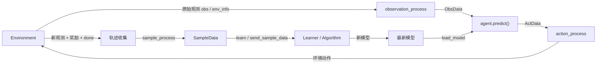
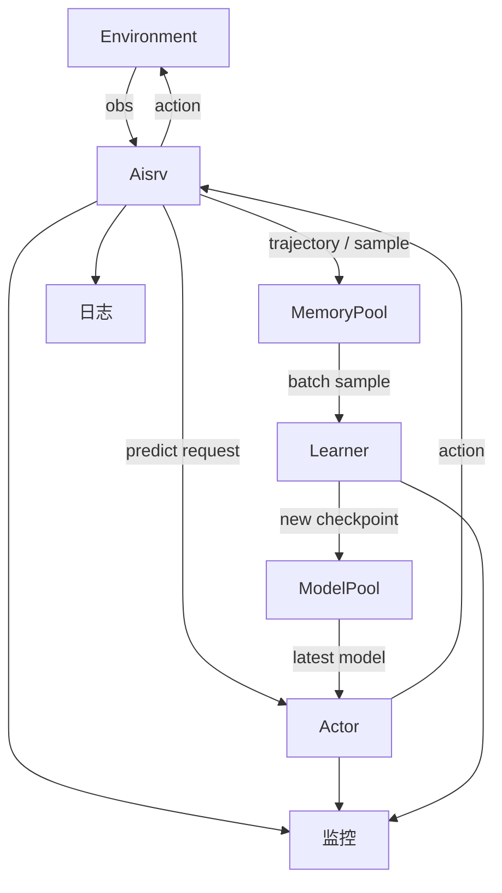

# KaiwuDRL《峡谷追猎》训练流程、环境协议与当前代码实现详解

## 1. 文档目的

这份文档把三类信息放到同一个坐标系里：

1. 赛题本身的目标、环境规则、数据协议与得分逻辑。
2. KaiwuDRL / 腾讯开悟的标准训练框架、分布式组件和开发接口。
3. 当前仓库 `gorge_chase` 的真实实现、已落地能力、未实现能力与后续改造方向。

目标不是简单复述官方文档，而是回答三个更实际的问题：

1. 这个题到底在优化什么。
2. KaiwuDRL 的训练流在这份代码里具体落在哪些文件。
3. 当前 PPO 基线离“充分利用环境能力”的版本还差什么。

---

## 2. 一句话结论

当前仓库已经具备一个**能跑通的 KaiwuDRL PPO 基线**，真实主线是 `agent_ppo/`，训练入口是 `train_test.py`，训练工作流入口是 `agent_ppo/workflow/train_workflow.py`。

但这份基线仍然是一个**有意收缩过能力边界的最简实现**：

- 环境真实动作空间是 **16 维**，当前代码只学了 **8 个移动动作**。
- 环境真实目标是 **生存 + 宝箱得分最大化**，当前奖励主要还是 **生存 + 怪物距离塑形**。
- 环境监控指标很丰富，当前代码上报的核心仍是 **PPO loss + reward + 少量 episode 指标**。
- 环境协议支持大量结构化信息，当前特征工程只用了其中一小部分。

换句话说，**当前仓库已经对齐了 KaiwuDRL 的基本训练范式，但还没有把赛题环境能力吃满**。

---

## 3. 真实运行层、框架层、项目层

为了避免把“官方抽象说明”和“当前仓库真实实现”混在一起，先分层：

| 层级 | 含义 | 当前项目里的体现 |
| --- | --- | --- |
| 环境层 | 峡谷追猎环境本身，负责 `reset / step`、地图、怪物、宝箱、buff、得分、合法动作等 | 由比赛环境与 KaiwuDRL 提供，不在当前仓库里完整实现 |
| 框架层 | KaiwuDRL 的 Agent / Workflow / Monitor / ModelPool / MemoryPool 等机制 | 通过 `kaiwudrl`、`tools`、`common_python` 提供 |
| 项目层 | 你作为选手真正能改的智能体代码包 | `agent_ppo/`、`agent_diy/`、`conf/`、`train_test.py` |

一个重要认知是：

- 环境规则由环境决定。
- 训练范式由 KaiwuDRL 框架组织。
- 你能优化的是特征、奖励、模型、算法、工作流和监控接入。

---

## 4. 赛题目标与环境规则

### 4.1 任务目标

任务是“路径规划 - 生存博弈”：

- 英雄是鲁班七号。
- 在限定步数内存活。
- 躲避最多 2 个怪物的追击。
- 尽可能多地收集宝箱提高总分。

本质上这是一个**多目标强化学习问题**：

1. 主目标：活得久。
2. 次目标：捡更多宝箱。
3. 隐含目标：合理利用闪现与 buff，避免走入死路。

### 4.2 地图与元素

地图是 `128 x 128` 的栅格地图，左上角是 `(0,0)`，`x` 向右，`z` 向下。

环境包含以下核心元素：

| 元素 | 含义 |
| --- | --- |
| 英雄 | 智能体控制对象，执行每个动作代表一步 |
| 怪物 | 追逐英雄，接触即失败 |
| 宝箱 | 收集得分，每个 100 分 |
| 加速 buff | 使英雄在一段时间内“一步两格” |
| 障碍物 | 阻挡普通移动与部分闪现落点 |
| 地图道路 | 可通行区域 |

### 4.3 失败与完成条件

- `terminated = true`：通常表示被怪物抓住，任务失败。
- `truncated = true`：通常表示达到最大步数或异常中断。
- 达到 `max_step` 且未被抓住，可以视为“完成”或“存活成功”。

### 4.4 得分规则

任务总分：

```text
total_score = step_score + treasure_score
step_score = finished_steps × 1.5
treasure_score = treasures_collected × 100
```

这里必须区分两个概念：

- `Score`：环境定义的任务表现指标，用来衡量最终效果。
- `Reward`：强化学习训练时你自定义的训练信号，可以和 `Score` 一致，也可以不一致。

当前仓库的一个重要简化，就是**Reward 并没有完全等于环境 Score**。

---

## 5. 环境配置入口

环境配置通过 `agent_算法名/conf/train_env_conf.toml` 注入。

当前 PPO 主线对应：

```toml
agent_ppo/conf/train_env_conf.toml
```

关键配置包括：

| 配置项 | 说明 | 当前默认值 |
| --- | --- | --- |
| `map` | 训练地图列表 | `[1..10]` |
| `map_random` | 是否随机选图 | `false` |
| `treasure_count` | 宝箱数量 | `10` |
| `buff_count` | buff 数量 | `2` |
| `buff_cooldown` | buff 刷新时间 | `200` |
| `talent_cooldown` | 闪现冷却 | `100` |
| `monster_interval` | 第二只怪物出现时间 | `300` |
| `monster_speedup` | 怪物加速时间 | `500` |
| `max_step` | 最大步数 | `1000` |

这些配置只直接作用于**训练环境**。评估任务的环境配置通常在平台侧设置。

---

## 6. 动作空间、观测协议与环境信息

### 6.1 真实动作空间

环境真实动作空间是 **16 维离散动作**：

| 范围 | 类型 | 含义 |
| --- | --- | --- |
| `0-7` | 移动 | 八方向移动 |
| `8-15` | 闪现 | 八方向闪现 |

闪现规则：

- 上下左右：10 格。
- 四个对角：8 格。
- 有冷却。
- 若目标不可通行，则回退到路径上最远可通行格。
- 路径上的宝箱和 buff 会被收集。

### 6.2 当前基线的动作空间

当前代码中的 PPO 基线把动作空间收缩成了 **8 维移动动作**：

- `agent_ppo/conf/conf.py` 中 `ACTION_NUM = 8`
- `agent_ppo/feature/preprocessor.py` 中只保留了前 8 维合法动作
- `agent_ppo/model/model.py` 的 actor head 只输出 8 维 logits

这意味着当前模型：

- 不会主动使用闪现。
- 也不会学习“什么时候闪现、朝哪边闪现最划算”。

### 6.3 观测结构

环境返回的核心观测包括：

| 字段 | 含义 |
| --- | --- |
| `step_no` | 当前步数 |
| `frame_state` | 当前帧状态 |
| `env_info` | 环境统计信息 |
| `map_info` | 以英雄为中心的 `21 x 21` 局部地图 |
| `legal_act` / `legal_action` | 合法动作掩码 |

`frame_state` 里通常包含：

- `heroes`
- `monsters`
- `organs`（宝箱、buff 等）

`env_info` 里通常包含：

- `total_score`
- `step_score`
- `treasure_score`
- `finished_steps`
- `flash_count`
- `flash_cooldown`
- `total_buff`
- `collected_buff`
- `total_treasure`
- `treasures_collected`
- `monster_interval`
- `monster_speed`
- `max_step`

---

## 7. 官方训练流程与当前项目的对齐方式

### 7.1 概念层训练流程

官方给出的完整训练流可以概括为：

1. 环境输出原始观测与奖励。
2. 智能体进行观测处理，形成 `ObsData`。
3. 智能体调用 `predict()` 生成 `ActData`。
4. 智能体进行动作处理，变成环境可接受的动作。
5. 环境执行动作，完成一次状态转移。
6. 采集轨迹数据。
7. 轨迹经过样本处理，形成 `SampleData`。
8. Learner 消费训练样本，更新模型。
9. Actor / Agent 加载最新模型，继续与环境交互。

### 7.2 用 Mermaid 表达概念流



### 7.3 当前仓库中的真实落点

在当前仓库里，这个流程对应关系如下：

| 概念 | 当前文件 |
| --- | --- |
| 训练入口 | `train_test.py` |
| 环境配置读取 | `agent_ppo/workflow/train_workflow.py` |
| 观测处理 | `agent_ppo/agent.py` -> `agent_ppo/feature/preprocessor.py` |
| 动作处理 | `agent_ppo/agent.py::action_process` |
| 样本定义 | `agent_ppo/feature/definition.py` |
| 样本后处理 | `agent_ppo/feature/definition.py::sample_process` |
| 模型 | `agent_ppo/model/model.py` |
| 算法 | `agent_ppo/algorithm/algorithm.py` |
| 训练工作流 | `agent_ppo/workflow/train_workflow.py` |
| 监控面板定义 | `agent_ppo/conf/monitor_builder.py` |

---

## 8. KaiwuDRL 分布式计算框架理解

### 8.1 组件角色

KaiwuDRL 的核心组件可以理解为：

| 组件 | 职责 |
| --- | --- |
| `Environment` | 跑环境，负责状态转移与原始观测 |
| `Aisrv` | 训练流程中枢，连接环境、Actor、Learner |
| `Actor` | 预测服务，调用 `predict()` / `exploit()` |
| `Learner` | 训练服务，调用 `learn()` 更新模型 |
| `MemoryPool` | 样本池，缓存训练样本 |
| `ModelPool` | 模型池，缓存模型参数 |
| 日志 | 采集运行日志 |
| 监控 | 采集资源与训练指标 |

### 8.2 分布式架构数据流



### 8.3 当前仓库更接近哪种模式

当前 `agent_ppo/workflow/train_workflow.py` 的行为更接近**分布式训练中的 Actor / Aisrv 侧采样流程**：

- 交互采样发生在 `workflow` 里。
- 轨迹转成 `SampleData` 后，并不是直接 `agent.learn(g_data)`。
- 当前工作流调用的是 `agent.send_sample_data(g_data)`。

这表明：

1. 当前训练工作流更偏“采样 + 投递样本”。
2. Learner 侧真正的 `learn()` 调用由框架调度。
3. 这与官方“分布式训练时样本发往样本池，Learner 按批训练”的说明是一致的。

---

## 9. 代码包结构与当前仓库映射

官方的标准代码包结构可以抽象成：

```text
root/
├── agent/
│   ├── algorithm/
│   ├── conf/
│   ├── feature/
│   ├── model/
│   ├── workflow/
│   └── agent.py
├── conf/
├── log/
└── train_test.py
```

当前仓库的真实映射是：

```text
code/
├── agent_ppo/          # 当前真实主线
├── agent_diy/          # 模板 / 备选实现
├── conf/               # 全局训练配置与算法绑定
├── ckpt/               # 模型文件目录
└── train_test.py       # 本地/测试训练入口
```

### 9.1 `agent_ppo/`

当前真实主线，核心文件职责如下：

| 路径 | 作用 |
| --- | --- |
| `agent_ppo/agent.py` | 智能体主类，组织 predict / exploit / learn / load/save model |
| `agent_ppo/feature/preprocessor.py` | 特征处理 + 即时奖励 |
| `agent_ppo/feature/definition.py` | `ObsData` / `ActData` / `SampleData` 定义与 GAE |
| `agent_ppo/model/model.py` | Actor-Critic 神经网络 |
| `agent_ppo/algorithm/algorithm.py` | PPO loss 和优化 |
| `agent_ppo/workflow/train_workflow.py` | episode 循环、样本收集与上报 |
| `agent_ppo/conf/conf.py` | 维度与超参数 |
| `agent_ppo/conf/train_env_conf.toml` | 环境配置 |
| `agent_ppo/conf/monitor_builder.py` | 监控面板定义 |

### 9.2 `agent_diy/`

这是模板骨架，适合你自己重写算法或做大改，但当前不是默认主线。

### 9.3 `conf/`

当前目录承担的是项目级配置，不是智能体逻辑：

| 文件 | 作用 |
| --- | --- |
| `conf/algo_conf_gorge_chase.toml` | 绑定 `ppo` / `diy` 到各自 agent、workflow |
| `conf/app_conf_gorge_chase.toml` | 应用级策略绑定 |
| `conf/configure_app.toml` | ReplayBuffer、batch size、dump 频率、预加载模型等配置 |

---

## 10. 当前 PPO 基线的真实实现

### 10.1 观测处理

当前 `agent_ppo/feature/preprocessor.py` 实现了一个 **40 维简化特征**：

| 部分 | 维度 | 内容 |
| --- | --- | --- |
| 英雄自身 | 4 | 位置、闪现冷却、buff 剩余时间 |
| 怪物1 | 5 | 是否在视野、位置、速度、距离 |
| 怪物2 | 5 | 同上 |
| 局部地图 | 16 | `4 x 4` 通行性裁剪 |
| 合法动作 | 8 | 仅移动动作掩码 |
| 进度 | 2 | 当前步数比例、生存比例 |
| 合计 | 40 | 当前模型输入维度 |

这是一个典型的“先跑起来”的最小特征集。

### 10.2 动作处理

当前 `agent_ppo/agent.py`：

- `predict()` 用模型输出概率分布并随机采样动作。
- `exploit()` 用贪心动作做评估。
- `action_process()` 直接把动作 id 变成环境动作。

这里说明当前环境动作协议足够简单：**动作就是整数离散 id**。

### 10.3 样本处理

当前样本管线是：

1. 每一步交互后，构造一个 `SampleData`。
2. episode 结束后，调用 `sample_process()`。
3. `sample_process()` 填充 `next_value`。
4. 用 `_calc_gae()` 计算 `advantage` 和 `reward_sum`。

这是一条标准 PPO 轨迹后处理链。

### 10.4 模型结构

当前模型是标准 Actor-Critic MLP：

```text
40D 输入
 -> Linear(40, 128) + ReLU
 -> Linear(128, 64) + ReLU
 -> Actor Head(64 -> 8)
 -> Critic Head(64 -> 1)
```

模型足够轻量，优点是：

- 跑得快。
- 容易调试。
- 适合作为框架通路验证。

缺点是：

- 表达能力有限。
- 对复杂局部结构、风险路径质量、宝箱/buff 权衡建模能力偏弱。

### 10.5 算法实现

当前算法是标准 PPO：

```text
total_loss = vf_coef * value_loss + policy_loss - beta * entropy_loss
```

包含：

- clipped policy loss
- clipped value loss
- entropy regularization
- gradient clipping

### 10.6 训练工作流

当前 `workflow` 做了这些事：

1. 读取 `train_env_conf.toml`。
2. reset 环境。
3. reset agent。
4. load 最新模型。
5. 进行 episode 交互循环。
6. 构造并累计 `SampleData`。
7. episode 结束后做 `sample_process()`。
8. 调用 `agent.send_sample_data(g_data)` 发样本。
9. 按时间间隔保存模型。

这条流程已经完整体现了：

- 环境交互
- 轨迹收集
- 样本后处理
- 样本送训
- 模型滚动更新

---

## 11. 官方抽象接口与当前仓库接口的一个关键差异

官方文档常用的抽象形式是：

```python
obs, state = env.reset(usr_conf=usr_conf)
frame_no, _obs, score, terminated, truncated, _state = env.step(act)
```

但当前仓库在 `train_workflow.py` 里用的是一个更“打包化”的环境封装：

```python
env_obs = env.reset(self.usr_conf)
env_reward, env_obs = self.env.step(act)
terminated = env_obs["terminated"]
truncated = env_obs["truncated"]
```

这说明：

1. 官方说明是框架抽象接口。
2. 当前项目实际接到的是一个经过封装的环境对象。
3. 你改智能体时，要以**当前仓库实际字段结构**为准，而不是照搬最原始的接口签名。

这是阅读 KaiwuDRL 项目时非常容易误判的一点。

---

## 12. 当前实现与赛题能力的主要差距

### 12.1 动作空间差距

官方环境支持 16 动作，当前基线只有 8 动作。

影响：

- 无法主动使用闪现脱险。
- 无法利用闪现路径收集宝箱与 buff。
- 无法学习“闪现换安全边际”。

这是当前基线和赛题上限之间最大的缺口之一。

### 12.2 特征工程差距

当前特征没有显式编码以下高价值信息：

- 宝箱方向、距离、密度、可达性。
- buff 方向、距离、剩余刷新时间。
- 视野外怪物的方向桶、距离桶。
- 怪物出生规则和“第二怪物会在 10 步前位置出现”的时序信息。
- 当前动作是否会逼近死角。
- 闪现后落点安全性。
- 路径宽度、可逃逸分支数量、局部拥塞度。

### 12.3 奖励设计差距

当前奖励以“活着”和“远离怪物”为主，没有很好体现：

- 宝箱收益。
- buff 获取价值。
- 合理闪现收益。
- 接近结束阶段时的风险控制。
- 对“活下来但到处乱跑”和“高分存活”的区分。

### 12.4 监控差距

环境本身暴露了很多指标，但当前监控面板主要还是：

- `reward`
- `total_loss`
- `value_loss`
- `policy_loss`
- `entropy_loss`

另外，工作流还上报了：

- `episode_steps`
- `episode_cnt`

但还没有把官方环境监控指标系统性纳入同一块面板。

### 12.5 模型表达能力差距

当前模型是很干净的 MLP，但对以下结构不够敏感：

- 复杂局部地图拓扑
- 风险路径评估
- 多目标权衡
- 闪现与移动的组合策略

---

## 13. 最值得优先推进的改造路线

如果以“投入产出比”排序，建议优先级如下。

### 13.1 第一优先级：补齐 16 动作

需要联动修改：

- `agent_ppo/conf/conf.py`
- `agent_ppo/feature/preprocessor.py`
- `agent_ppo/feature/definition.py`
- `agent_ppo/model/model.py`
- `agent_ppo/agent.py`
- `agent_ppo/algorithm/algorithm.py`

核心变化：

- `ACTION_NUM: 8 -> 16`
- 合法动作掩码扩成 16 维
- actor head 输出 16 维
- 样本中的 `prob` / `legal_action` 同步扩维

### 13.2 第二优先级：补宝箱与 buff 特征

最低建议先加入：

- 最近宝箱的方向与距离
- 最近 buff 的方向与距离
- 当前 `treasures_collected`
- 当前 `collected_buff`
- `flash_count`
- `monster_interval`
- `monster_speed`

### 13.3 第三优先级：重做奖励设计

推荐至少加入以下项：

- 生存基础奖励
- 与怪物安全距离塑形
- 宝箱收集奖励
- buff 获取奖励
- 死亡惩罚
- 达到 `max_step` 的存活奖励
- 合理闪现奖励或危险时不闪现惩罚

### 13.4 第四优先级：补环境监控

建议把环境指标和算法指标统一到面板里，例如：

- `total_score`
- `step_score`
- `treasure_score`
- `finished_steps`
- `flash_count`
- `treasures_collected`
- `collected_buff`
- `monster_speed`
- `monster_interval`

### 13.5 第五优先级：增强模型结构

当特征和奖励已经明显限制效果时，再考虑：

- 更宽或更深的 MLP
- 局部地图卷积或 patch 编码
- 多头 value
- 带时序状态的模型

---

## 14. 监控体系怎么理解

当前仓库其实已经有两条监控线：

### 14.1 算法监控

来自 `agent_ppo/algorithm/algorithm.py`：

- `total_loss`
- `value_loss`
- `policy_loss`
- `entropy_loss`
- `reward`

### 14.2 episode 监控

来自 `agent_ppo/workflow/train_workflow.py`：

- `reward`
- `episode_steps`
- `episode_cnt`

### 14.3 面板定义

来自 `agent_ppo/conf/monitor_builder.py`，当前面板只正式定义了：

- `reward`
- `total_loss`
- `value_loss`
- `policy_loss`
- `entropy_loss`

因此要在平台监控里更完整地看训练是否有效，后续应该：

1. 扩 monitor builder 面板定义。
2. 在 workflow 或 algorithm 中上报更多环境指标。
3. 把“训练 reward 上升”和“真实 total_score 上升”同时看。

---

## 15. 配置层应如何理解

### 15.1 环境配置

位置：

```text
agent_ppo/conf/train_env_conf.toml
```

作用：

- 控制地图、怪物、宝箱、buff、步数等环境条件。

### 15.2 训练框架配置

位置：

```text
conf/configure_app.toml
```

作用：

- 控制 replay buffer
- 控制 batch size
- 控制样本池的采样与淘汰策略
- 控制模型保存与同步
- 控制是否加载预训练模型

这两个配置文件不要混淆：

- `train_env_conf.toml` 决定“环境长什么样”。
- `configure_app.toml` 决定“训练系统怎么跑”。

---

## 16. On-Policy / Off-Policy 的位置与当前项目理解

官方说明中给出了两种训练范式：

| 范式 | 特点 |
| --- | --- |
| On-Policy | 使用当前策略最新采样数据，稳定但数据利用率较低 |
| Off-Policy | 可复用历史样本，数据效率更高 |

PPO 通常属于 **On-Policy** 一侧。

这和当前项目的关系是：

- 算法主体是 PPO。
- 但框架层仍可能存在样本池、模型池、同步机制。
- 也就是说，**框架形态分布式**，并不意味着**算法就是 off-policy**。

看项目时要区分：

1. 算法的数据假设。
2. 框架的数据搬运方式。

---

## 17. 预训练模型与继续训练

当前项目支持预加载模型继续训练。

关键配置在 `conf/configure_app.toml`：

```toml
preload_model = false
preload_model_dir = "{agent_name}/ckpt"
preload_model_id = 1000
```

含义：

- `preload_model = true` 时启用预训练模型。
- `preload_model_dir` 指向模型所在目录。
- `preload_model_id` 对应 `model.ckpt-xxxx.pkl` 文件中的编号。

使用预训练模型时必须保证：

1. 模型结构一致。
2. 文件命名一致。
3. 加载路径与 agent 名字匹配。

---

## 18. 当前仓库最重要的开发认知

### 18.1 你真正能改的核心不是环境，而是智能体包

主要改动点集中在：

- `agent_ppo/feature/`
- `agent_ppo/model/`
- `agent_ppo/algorithm/`
- `agent_ppo/workflow/`
- `agent_ppo/conf/monitor_builder.py`

### 18.2 赛题提升空间主要来自“更懂环境”

不是先换更复杂算法，而是先把这些用好：

- 闪现
- 宝箱
- buff
- 怪物时序
- 局部地图拓扑
- 环境统计指标

### 18.3 当前基线的主要价值是“验证训练链路”

它的第一目标不是拿高分，而是：

- 跑通环境交互
- 跑通样本处理
- 跑通 PPO 更新
- 跑通监控与模型保存

因此看到它很简化，是正常的，不是代码写漏了，而是故意保守。

---

## 19. 一个面向后续改造的建议路线图

### 阶段 1：先把协议吃满

- 动作从 8 扩到 16
- 合法动作掩码全量使用
- 特征里纳入宝箱/buff/视野外怪物信息

### 阶段 2：让 reward 真正服务于总分

- 引入宝箱奖励
- 引入 buff 奖励
- 区分“安全探索”和“盲目乱跑”
- 对死亡进行更强约束

### 阶段 3：监控对齐真实目标

- 同时观察 loss、reward、total_score、treasures_collected、finished_steps
- 把“模型看起来在学”和“平台分数真的上涨”区分开

### 阶段 4：再考虑模型升级

- 更强表征
- 时序建模
- 路径质量建模

---

## 20. 最后的总结

如果把这一整套系统浓缩成一句话，可以这样理解：

> KaiwuDRL 负责把“环境交互、样本流转、模型同步、训练调度”组织起来，而你在当前仓库中真正需要做的，是把 `agent_ppo/` 这套智能体从“能活的最小 PPO baseline”，逐步升级成“会闪现、会权衡宝箱收益、会利用 buff、会规避死路、能在多地图上泛化”的高分策略。

当前仓库已经把训练链路打通了，但离题目能力上限还有明显空间。后续最值钱的改造，不是先追求复杂框架，而是：

1. 把动作空间补齐。
2. 把特征工程补齐。
3. 把奖励设计对准总分。
4. 把监控和真实目标对齐。

当这四件事都做到位之后，再去加深模型和进一步做结构升级，性价比会更高。
